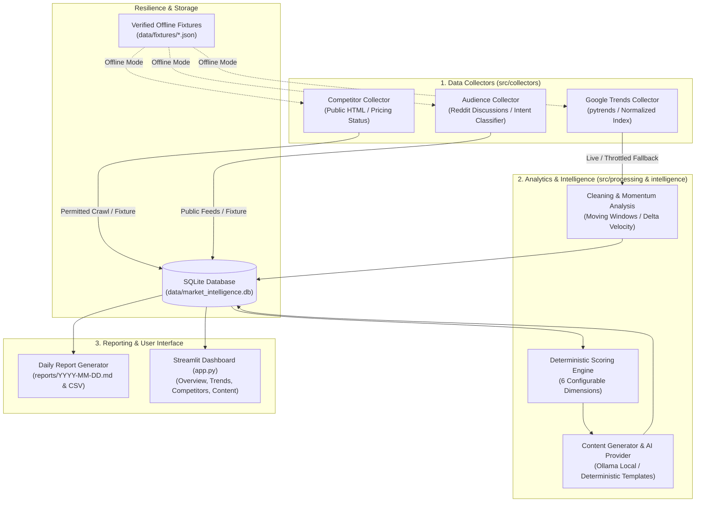

# AI Market Demand & Growth Intelligence Agent

[](https://github.com/example/market-demand-intelligence/actions)
[](https://www.python.org/)
[](https://streamlit.io/)
[](https://www.sqlite.org/)
[](LICENSE)

An autonomous, verifiable market research and organic growth intelligence system designed to identify genuine search demand velocity, audit competitor course catalogs, extract audience friction points, calculate deterministic opportunity rankings (0–100), and produce automated executive intelligence reports.

Built primarily for online education course topics (e.g., Python Programming, Data Analytics, Artificial Intelligence, Digital Marketing) across India and global markets, the system features a configurable architecture extensible to any industry.

---

## Key Highlights & Core Differentiators

- **Zero API Cost & 100% Free Stack:** Works completely out-of-the-box without requiring paid OpenAI/Claude API keys. Operates with deterministic rule synthesis and optional local open-source LLMs via Ollama.
- **Empirical Evidence First:** Prioritizes verifiable observations from Google Trends and permitted public domain endpoints over generic AI hallucinations.
- **Normalized Index Truthfulness:** Accurately reflects Google Trends' normalized relative interest indices (0–100) instead of fabricating synthetic monthly query volumes or difficulty metrics.
- **6-Factor Deterministic Scoring Engine:** Computes reproducible 0–100 opportunity scores with explicit dimension contributions and confidence ratings (*High, Medium, Low*).
- **Competitor Transparency:** Labels competitor pricing as verified or explicitly flags *"Not publicly verified"* when pricing requires admissions consultation or sales calls.
- **Resilient Multi-Source Pipeline:** Failures or rate-limiting in individual external collectors (e.g. Google Trends 429 or Reddit 403) trigger graceful fallbacks to curated offline fixtures without crashing the orchestrator.
- **Comprehensive Daily Briefings:** Automatically renders Markdown briefings (`reports/YYYY-MM-DD.md`) and companion CSV exports with complete provenance labeling (*Observed Data*, *Derived Analysis*, *AI Synthesis*).
- **Interactive Streamlit Web Dashboard:** 7 modular views with interactive Plotly visual charts, KPI metric cards, filters, and on-demand report downloaders.

---

## System Architecture



---

## Deterministic Opportunity Scoring Formula

Every keyword and opportunity is scored deterministically on a **0 to 100 scale** using 6 transparent, weighted dimensions configured in `config/settings.yaml`:

$$\text{Opportunity Score} = \sum_{i=1}^{6} w_i \cdot S_i$$

| Dimension | Default Weight ($w_i$) | Input Source | Description & Normalization |
| :--- | :---: | :--- | :--- |
| **Demand Evidence** | **30%** | Google Trends (Live / Fixture) | Normalized relative interest index ($0–100$). Unobserved topics default to $25.0$ with quality penalty. |
| **Industry Relevance** | **20%** | Taxonomy Configuration | Direct curriculum alignment ($95.0$) vs peripheral topic ($70.0$). |
| **Growth Momentum** | **15%** | Velocity Calculations | Shift between recent window and prior baseline ($50.0 + 5.0 \times \Delta$). Clipped to $[0, 100]$. |
| **Competitive Opportunity** | **15%** | Competitor Intelligence | White-space gap. **Missing competitor data is NEVER assumed to mean low competition** (assigned neutral $50.0$). |
| **Audience Intent** | **10%** | Community Classifier | Commercial intent tier: Purchase ($95$), Comparison ($90$), Career ($85$), Practical Skill ($75$), Info ($65$). |
| **Evidence Quality** | **10%** | Provenance Audit | Number of independent source types ($\ge 2$), data freshness, and live vs demo fixture bonus. |

### Confidence Classification
- **High Confidence:** Evidence Quality $\ge 80/100$ and $\ge 2$ independent sources confirmed.
- **Medium Confidence:** Evidence Quality $\ge 60/100$.
- **Low Confidence:** Partial signals or single unconfirmed source.

---

## Project Structure

```
market-intelligence-agent/
│
├── app.py                     # Streamlit web dashboard (7 comprehensive views)
├── requirements.txt           # Verified Python dependencies
├── .env.example               # Environment template
├── .gitignore                 # Safe git exclusion rules
├── LICENSE                    # MIT License
├── README.md                  # Complete documentation and quickstart
│
├── config/
│   └── settings.yaml          # Industry, keywords, competitors, weights, timeouts
│
├── src/
│   ├── __init__.py
│   ├── config.py              # Pydantic configuration loader & validation
│   ├── pipeline.py            # Master resilient orchestrator
│   ├── collectors/            # Modular public collectors
│   │   ├── __init__.py
│   │   ├── google_trends.py   # Google Trends relative interest collector
│   │   ├── competitor_collector.py # Competitor pricing & catalog auditor
│   │   └── audience_collector.py   # Learner community & intent classifier
│   ├── processing/            # Data engineering
│   │   ├── __init__.py
│   │   ├── cleaning.py        # Sanitization & deduplication
│   │   └── trend_analysis.py  # Velocity & direction momentum math
│   ├── intelligence/          # AI & scoring engine
│   │   ├── __init__.py
│   │   ├── opportunity_scoring.py  # 6-factor deterministic scoring engine
│   │   ├── content_ideas.py   # Actionable organic marketing planner
│   │   └── ai_provider.py     # Local Ollama interface + deterministic fallback
│   ├── storage/
│   │   ├── __init__.py
│   │   └── database.py        # SQLite schema, indexing & query helpers
│   └── reporting/
│       ├── __init__.py
│       └── daily_report.py    # Markdown & CSV daily intelligence generator
│
├── scripts/
│   ├── run_pipeline.py        # CLI pipeline runner (supports live & --offline)
│   └── generate_report.py     # CLI daily report generator
│
├── tests/                     # 17 Unit, integration & e2e smoke tests
│   ├── conftest.py            # Pytest fixtures & isolated in-memory DBs
│   ├── test_scoring.py        # Score bounds, weights & determinism tests
│   ├── test_storage.py        # Database schema, upsert & deduplication tests
│   ├── test_processing.py     # Cleaning & momentum calculation tests
│   ├── test_reporting.py      # Markdown report & CSV export tests
│   ├── test_collectors.py     # Collector resilience & fallback tests
│   └── test_e2e_pipeline.py   # End-to-end pipeline execution smoke test
│
├── data/
│   ├── README.md
│   ├── market_intelligence.db # SQLite database (created on first run)
│   └── fixtures/              # Curated, verifiable offline datasets
│       ├── trends_sample.json
│       ├── competitors_sample.json
│       └── audience_sample.json
│
├── reports/
│   ├── README.md
│   ├── 2026-10-20.md          # Sample daily markdown intelligence report
│   └── 2026-10-20_opportunities.csv # Companion tabular opportunities export
│
└── .github/
    └── workflows/
        └── ci.yml             # Automated GitHub Actions test workflow
```

---

## Installation & Setup

### Prerequisites
- Python 3.10 or 3.11 installed.
- Git installed.
- (Optional) [Ollama](https://ollama.ai/) installed locally if you wish to run a local open-source LLM (`ollama run llama3.2`). The application functions with 100% feature completeness without Ollama.

### 1. Clone the Repository
```bash
git clone https://github.com/example/market-demand-intelligence.git
cd market-demand-intelligence
```

### 2. Create and Activate Virtual Environment
```bash
# Windows (PowerShell)
python -m venv venv
.\venv\Scripts\Activate.ps1

# Linux / macOS
python3 -m venv venv
source venv/bin/activate
```

### 3. Install Dependencies
```bash
pip install --upgrade pip
pip install -r requirements.txt
```

### 4. Configure Environment
```bash
# Copy template
cp .env.example .env
```
*(No API keys are required for core operations. Everything is configured via `config/settings.yaml` and `.env`)*

---

## Running the Application

### 1. Execute the Market Intelligence Pipeline
To ingest market observations, audit competitors, discover learner needs, calculate opportunity scores, and generate reports:

```bash
# Run with live data collection (with automatic resilience fallbacks)
python scripts/run_pipeline.py

# Force offline demo mode (uses verified local fixtures, zero network calls)
python scripts/run_pipeline.py --offline

# Target a specific category
python scripts/run_pipeline.py --category python-programming
```

### 2. Launch the Streamlit Web Dashboard
```bash
streamlit run app.py
```
Open your browser at `http://localhost:8501`.

### 3. Generate Daily Reports On-Demand
```bash
python scripts/generate_report.py
```
Outputs:
- Markdown Briefing: `reports/YYYY-MM-DD.md`
- Tabular Opportunities CSV: `reports/YYYY-MM-DD_opportunities.csv`

---

## Running the Automated Test Suite

The project includes 17 unit, integration, and end-to-end smoke tests that execute in under 12 seconds with zero network dependencies:

```bash
# Run complete test suite
pytest -v

# Run with test coverage report
pytest --cov=src -v
```

### Test Coverage Highlights:
- **`test_scoring.py`**: Verifies opportunity score bounds $[0, 100]$, validates weight summation enforcement, tests determinism, and strictly verifies that missing competitor data is never treated as low competition.
- **`test_storage.py`**: Tests SQLite table initializations, conflict resolution (`ON CONFLICT DO UPDATE`), and deduplication constraints.
- **`test_processing.py`**: Tests data cleaning, type sanitization, moving window momentum calculations, and direction categorization.
- **`test_reporting.py`**: Tests report rendering, Markdown alert injection, and CSV generation.
- **`test_collectors.py`**: Tests offline fallback handling for Google Trends and competitor scrapers, and verifies audience intent classification.
- **`test_e2e_pipeline.py`**: End-to-end smoke test executing the full pipeline against an isolated temporary database.

---

## 3–5 Minute Demonstration Script

Follow this structured workflow for evaluation or demonstration:

1. **Launch Dashboard:** Start `streamlit run app.py` and navigate to `http://localhost:8501`.
2. **Review Overview KPIs:** Inspect the **Overview** page showing total tracked keywords, competitor course offerings, collected audience discussions, and pipeline execution health.
3. **Explore Search Demand:** Open **Demand Explorer**. Select the category `Python programming` and geography `India`. Observe the interactive Plotly time-series chart showing relative interest (0–100) and notice the data methodology badge clarifying normalized index semantics.
4. **Inspect Competitor Landscape:** Click **Competitor Analysis**. Review the pricing table comparing Coursera, Udemy, Great Learning, and Simplilearn. Note that unverified courses requiring admissions counseling are labeled *"Not publicly verified"*, while verified courses display their actual prices.
5. **Analyze Learner Voice:** Navigate to **Audience Insights**. View the breakdown of student intents (*Purchase-Oriented, Comparison, Skill Development, Career Switch*) and examine the source links to public learner questions.
6. **Evaluate Opportunity Rankings:** Navigate to **Opportunity Ranking**. View the top-ranked opportunities sorted by score. Click on any topic to inspect the **Score Audit Inspector**, showing the weighted contribution of all 6 components (*Demand, Relevance, Momentum, Competition, Intent, Evidence*).
7. **Review Actionable Content Ideas:** Open **Content Planner**. Review high-ROI content concepts (Tutorials, Comparison Guides, Free Lead Magnets) that map directly to verified student pain points. Download the content plan CSV.
8. **Inspect Daily Briefing:** Open **Reports & Data Quality**. View today's executive intelligence report and download the complete Markdown and CSV files.
9. **Demonstrate Resilient Fallback:** Disconnect your network or click **📦 Load Demo** in the sidebar. Notice how the dashboard and pipeline handle network throttling cleanly without failing.

---

## Daily Automation Setup

You can automate daily execution so that fresh intelligence reports and data updates occur autonomously every morning.

### On Windows (Task Scheduler)
1. Open PowerShell as Administrator.
2. Register a daily scheduled task to run at 06:00 AM:
```powershell
$Action = New-ScheduledTaskAction -Execute "C:\spearmint\task 4\venv\Scripts\python.exe" -Argument "scripts/run_pipeline.py" -WorkingDirectory "C:\spearmint\task 4"
$Trigger = New-ScheduledTaskTrigger -Daily -At 6am
Register-ScheduledTask -Action $Action -Trigger $Trigger -TaskName "DailyMarketIntelligenceAgent" -Description "Runs daily market demand pipeline and generates briefing report."
```

### On Linux / macOS (cron)
Add a crontab entry to execute daily at 06:00 UTC:
```bash
crontab -e
```
Add the line:
```cron
0 6 * * * cd /path/to/market-demand-intelligence && ./venv/bin/python scripts/run_pipeline.py >> pipeline.log 2>&1
```

---

## Data Provenance & Attribution Guidelines

All findings in this system adhere to rigorous research standards:
- **Observed Data:** Unmodified measurements retrieved from Google Trends or public competitor landing pages.
- **Derived Analysis:** Moving averages, relative velocity momentum, and the 6-factor deterministic opportunity score calculated strictly from observed data.
- **AI-Generated Suggestion:** Content formats, angles, and calls to action generated via local LLM or rule templates. AI is never allowed to fabricate source links or statistics.
- **Unverified Hypothesis:** Highlighted when a competitor hides pricing behind a sales funnel or when audience sample size is small.

---

## Known Limitations & Future Roadmap

- **Google Trends Normalization:** Google Trends provides normalized relative indices (0–100) within a selected window rather than absolute monthly search volumes. (This is documented transparently throughout the dashboard).
- **Public Forum Anti-Bot Policies:** Public forum endpoints (such as Reddit) frequently return HTTP 403 or 429 to automated scrapers unless registered API OAuth client credentials are provided. The system includes an automated fallback to curated offline fixtures.
- **Competitor Enterprise Pricing:** Enterprise programs frequently require prospective students to schedule an admissions counseling call; in such instances, the system records *"Not publicly verified"* to prevent price fabrication.
- **Future Enhancements:**
  - Official YouTube Data API v3 collector integration for video tutorial view velocity.
  - Multi-tenant workspace support.
  - Automated Slack / Discord / Email daily digest webhooks.

---

## Publishing to GitHub

To push this repository to GitHub:

```bash
# Initialize git (if not already initialized)
git init

# Add all files
git add .

# Commit files
git commit -m "feat: complete AI Market Demand & Growth Intelligence Agent"

# Link your GitHub remote and push
git branch -M main
git remote add origin https://github.com/<your-username>/market-demand-intelligence.git
git push -u origin main
```
